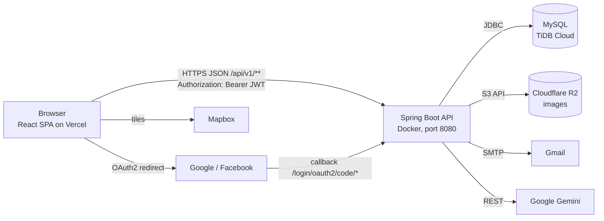
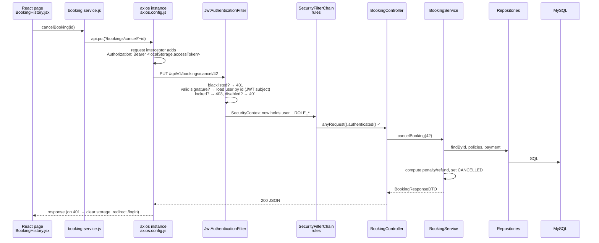

# Architecture

## System context



## Backend: classic layered Spring app

Package root: `src/main/java/com/example/smart_booking_system/`

```
controller/   HTTP layer: @RestController, maps URL → service call, wraps result
service/      business rules (@Service, @Transactional)
  impl/       some services split into interface + Impl (Auth, Property, Room, Email, OwnerApplication)
  ai/         Gemini chatbot + in-memory chat session state
repository/   Spring Data JPA interfaces (derived queries + @Query JPQL)
entity/       JPA @Entity classes = DB tables
dto/          request/response shapes (what goes over the wire)
enums/        status machines (BookingStatus, PaymentStatus, …)
security/     JWT filter, token provider, UserDetails, OAuth2 handlers
config/       SecurityConfig, R2Config, WebMvcConfig, dotenv loader
resources/db/changelog/   Liquibase migrations + seed data
scheduler/    @Scheduled background jobs
exception/    AppException hierarchy (i18n key + status) + GlobalExceptionHandler (@RestControllerAdvice)
i18n/         locale resolver (Accept-Language), Messages helper, UserLocales (users.preferredLanguage)
logging/      RequestIdFilter (MDC), LoggingAspect (@Aspect), LogSanitizer
util/         cookie helper
resources/templates/email/   Thymeleaf HTML email templates
```

Note: the code is **inconsistent** about layering — some services have interfaces (`AuthService` + `AuthServiceImpl`), most don't (`BookingService` is a concrete class). Controllers often `try/catch` and return `badRequest()` themselves instead of letting `GlobalExceptionHandler` do it. Services throw `AppException` subclasses (`BadRequestException("error.x.y", args)` …) whose message key is translated per request.

### Cross-cutting: language and logging
- Every request carries `Accept-Language` (axios adds it). `AcceptHeaderLocaleResolver` (vi default, en) puts it in `LocaleContextHolder`; `Messages.t(key, args)` uses it. Emails and notifications use the **recipient's** saved `users.preferredLanguage` instead. Details: [10](./10-i18n.md).
- `RequestIdFilter` tags each request with an id (MDC, echoed as `X-Request-Id`); `LoggingAspect` writes one INFO line per controller call and DEBUG/WARN/ERROR around services and jobs. Details: [11](./11-logging.md).

## The life of an authenticated request

Example: customer clicks **Cancel** on a booking.



### Security layers (two of them)

1. **URL rules** in `SecurityConfig.securityFilterChain()` — e.g. `/api/v1/auth/**` public, `/api/v1/admin/**` → `hasRole("ADMIN")`, everything else → authenticated.
2. **Method rules** with `@PreAuthorize("hasRole('OWNER')")` on controller methods (`@EnableMethodSecurity` is on).

Roles are stored as `CUSTOMER`/`OWNER`/`ADMIN` in the `roles` table; `CustomUserDetails` exposes them as `ROLE_CUSTOMER` etc., which is what `hasRole()` checks.

**Neither layer checks ownership** (is this *my* booking?). See gotchas.

### JWT details (`JwtTokenProvider`)
- Algorithm HS512, key = `app.jwt.secret` bytes.
- `sub` = userId (UUID string), claims `email`, `roles` (comma-joined).
- Expiry 24h. No refresh token. Logout writes the token to `BlackListedTokens` table.

### OAuth2 login
`/oauth2/authorization/google` → provider → `/login/oauth2/code/google` → `CustomOAuth2UserService` creates/links `User` + `SocialAccount` → `OAuth2AuthenticationSuccessHandler` mints a JWT and redirects to `${FRONTEND_URL}/oauth2/redirect?token=...` → `OAuth2RedirectHandler.jsx` stores it and calls `/auth/me`.

## Frontend structure

```
src/
  main.jsx → App.jsx  (AuthContextProvider > BrowserRouter > AppRoutes)
  routes/        index.jsx + CustomerRoutes / OwnerRoutes / AdminRoutes arrays, ProtectedRoute (role gate)
  layouts/       CustomerLayout, OwnerLayout, AdminLayout, AuthLayout (header/sidebar/notification dropdown)
  pages/         Customer/, Owner/, Admin/, Auth/, Partner/
  services/      one file per backend area: booking.service.js, payment.service.js, … all use axios.config.js
  context/       AuthContext (currentUser + login/logout), NotificationContext, Search, Theme, Language
  components/    common UI kit (Button, Modal, Table…), ai/ (chatbot, price forecast), payment/, search/
  i18n/          i18next setup + locales/{vi,en}/<namespace>.json
  store/         Redux scaffold — EMPTY files, not used
```

**Pattern to remember:** `page component → services/xxx.service.js → api (axios instance) → backend`. State that must survive navigation lives in Context + `localStorage` (`accessToken`, `user`).

`ProtectedRoute` only hides pages in the UI; the real enforcement is the backend.

## Background jobs (`scheduler/`)

| Job | Schedule | What |
|---|---|---|
| `BookingScheduler.checkExpiredBookings` | every 60 s | cancel `PENDING_PAYMENT` bookings older than 5 min |
| `BookingScheduler.sendCheckinReminders` | 08:00 daily | email guests checking in soon |
| `PromotionScheduler.autoExpirePromotions` | every minute | `ACTIVE` promos past `endDate` → `EXPIRED` |

## Further reading
- Spring Security servlet architecture (filter chain, SecurityContext) — https://docs.spring.io/spring-security/reference/servlet/architecture.html
- Spring task scheduling — https://docs.spring.io/spring-framework/reference/integration/scheduling.html
- axios interceptors — https://axios-http.com/docs/interceptors
