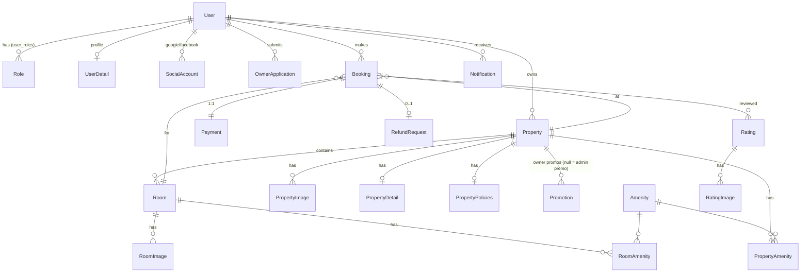

# Domain Model

Source: `entity/*.java`, `enums/*.java`. Table names in parentheses (they're inconsistent: `bookings`, `payment`, `registerOwner`, `PropertyAmenity`…).

## Entity-relationship diagram (core)

Also: `SystemLog` (audit trail: actor, action, entityType, old/new JSON), `SearchHistory`, `BlacklistedToken` (logged-out JWTs).

## Key entities — the fields that matter

### User (`users`)
`userId` = **UUID string** (all other IDs are int/long). `email` unique, `passwordHash` (BCrypt; null for social-only accounts), `isEmailVerified`, `status` (`"ACTIVE"`, locked…), `verificationToken`, `resetPasswordToken`, `points`, `membershipRank`, `roles` (EAGER many-to-many).

### Property (`properties`)
`propertyType` (HOTEL / RESORT / VILLA / HOMESTAY), `owner`, address parts (`city`, `district`, `ward`, codes), `latitude/longitude`, `rating` + `reviewCount` (denormalised), `propertyStatus`, **and** a separate `isActive` boolean.
- `propertyStatus` = admin's verdict. `isActive` = currently visible/bookable (owner can toggle when approved; suspend sets false).

### Room (`rooms`)
`pricePerNight` (weekday), `weekendPrice` (Sat/Sun nights), `capacity`, `roomAmount` (how many physical rooms of this type — **not used by booking logic**), `roomCategory`, `roomStatus`, `active`.

**Hotel vs Villa rule:** HOTEL/RESORT → many room types, customer picks `roomId`. VILLA/HOMESTAY → exactly one room with category `WHOLE`; customer must *not* send `roomId`.

### Booking (`bookings`)
`user`, `property`, `room`, `checkInDate`, `checkOutDate` (LocalDate, nights = checkIn..checkOut-1), `guestCount`, `totalPrice` (after discounts), `discountAmount`, `promotionCode` (owner code), `adminPromotionCode`, `penaltyAmount`, `refundAmount`, `status`, contact snapshot (`customerName/Phone/Email` — may differ from account when booking for someone else), `specialRequest`.

### Payment (`payment`) — 1:1 with Booking, created together
`paymentStatus`, `paymentMethod` (string from UI), `totalAmount`, `transactionReference` (`TRX_XXXXXXXX`, generated), `refundedAmount`.

### RefundRequest (`refund_requests`) — 0..1 per Booking
`amount`, bank info (`bankName`, `accountNumber`, `accountHolder`), `reason`, `adminNote`, `status`.

### Promotion (`promotions`)
`code`, `discountType` (PERCENTAGE / FIXED_AMOUNT), `discountValue`, `maxDiscountAmount`, `minBookingAmount`, `minMembershipRank`, `usageLimit`/`usageCount`, `startDate`/`endDate`, `status`, `property` (**null ⇒ admin/platform code**).

### PropertyPolicies (`property_policies`)
Check-in/out times, pets/smoking/children, **`allowFreeCancellation` + `freeCancellationDays`** (drives refund math), deposit, minimum age.

## Status enums (the state machines)

| Enum | Values | Meaning |
|---|---|---|
| `BookingStatus` | `PENDING_PAYMENT → CONFIRMED → CHECKED_IN → COMPLETED`, or `→ CANCELLED` | see flows |
| `PaymentStatus` | `PENDING`, `APPROVED` (paid), `REJECTED`, `REFUND_REQUESTED`, `REFUNDED` | |
| `RefundRequestStatus` | `PENDING`, `APPROVED`, `REJECTED` | |
| `PropertyStatus` | `PENDING`, `APPROVE` (sic, not APPROVED), `REJECTED`, `SUSPENDED` | |
| `ApplicationStatus` | `PENDING`, `APPROVED`, `REJECTED` | owner applications |
| `RoomStatus` | `AVAILABLE`, `BOOKED`, `MAINTENANCE`, `SUSPENDED` | |
| `PromotionStatus` | `ACTIVE`, `EXPIRED`, `PAUSED`, `DELETED` (soft delete) | |
| `MembershipRank` | `BRONZE` <1000 pts, `SILVER` ≥1000, `GOLD` ≥5000, `DIAMOND` ≥10000 | `BookingService.calculateRankFromPoints` |
| `RatingType` | `POSITIVE`, `NEGATIVE`, `VIOLATION` | |
| `NotificationType` | 24 values, grouped Customer / Owner / Admin | |
| `AuthProvider` | `local`, `google`, `facebook` (lower-case!) | |

## Further reading
- Spring Data JPA query methods (how `findByUserUserId` etc. become SQL) — https://docs.spring.io/spring-data/jpa/reference/jpa/query-methods.html
