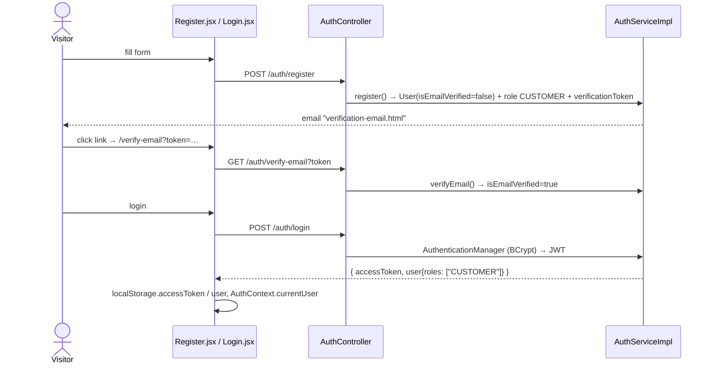
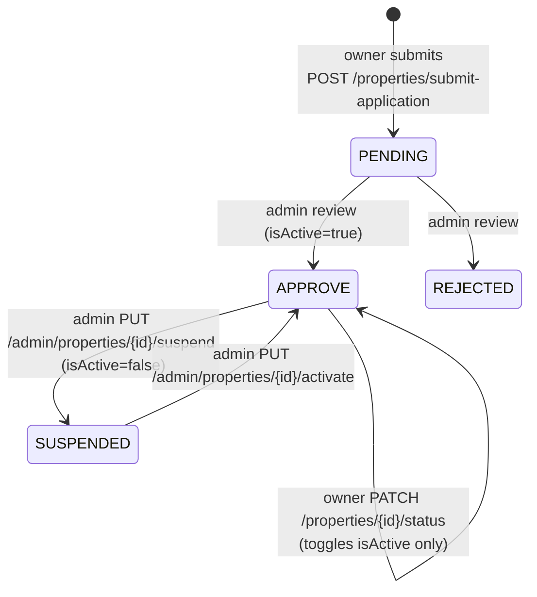
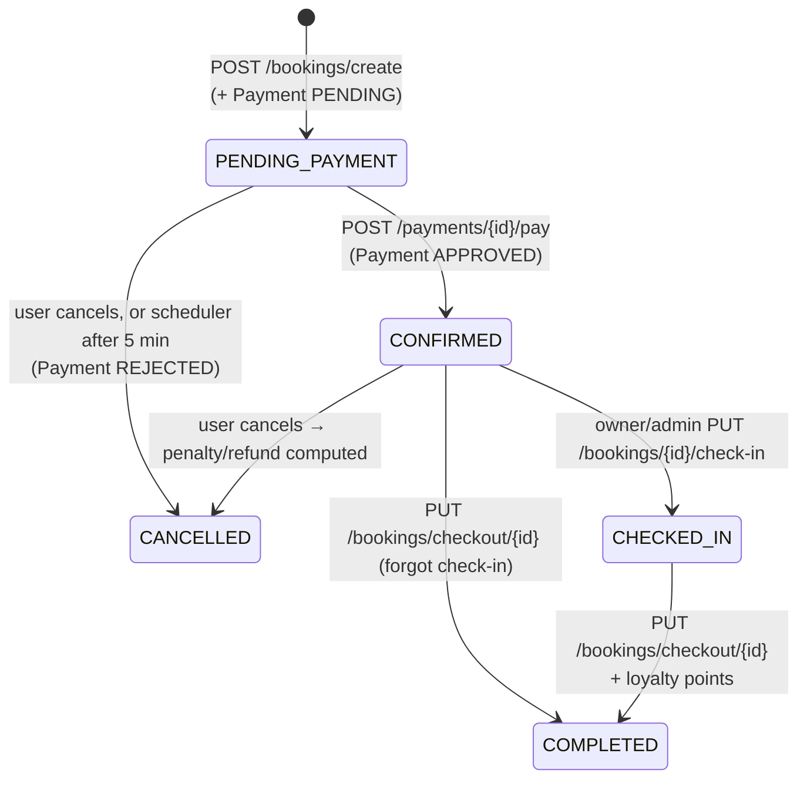
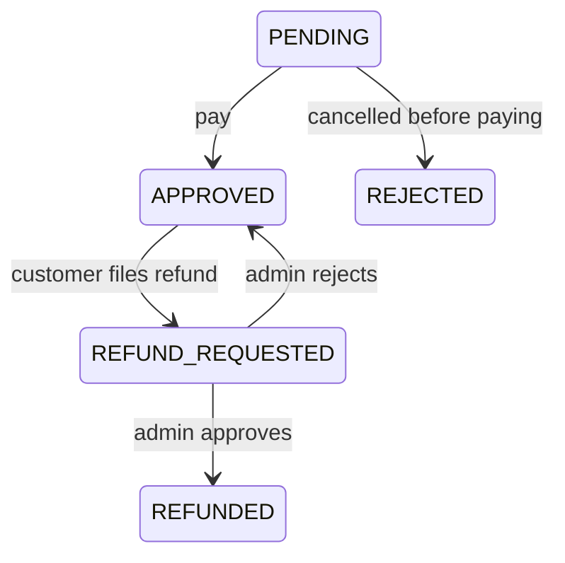
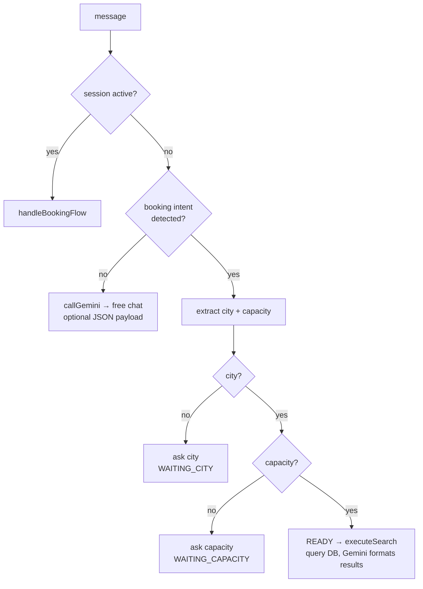

# Business Flows

Every flow lists: **who → which endpoint → which service method → what changes in the DB → side effects** (emails / notifications). Line numbers drift; search by method name.

---

## 1. Registration, verification, login

- Logout `POST /auth/logout` → token saved in `BlackListedTokens`; filter rejects it afterwards.
- Forgot password: `POST /auth/forgot-password` → email with reset token → `POST /auth/reset-password`.
- Social: see [03-architecture.md#oauth2-login](./03-architecture.md). Social-only users can later `POST /auth/create-password`; `DELETE /auth/social/unlink` removes a provider.

---

## 2. Customer → Owner (owner application)

1. Customer opens **Partner with us** (`/partner-with-us`, `/partner/register`).
2. `POST /api/v1/applications/submit-owner` (multipart: ID card front/back, business licence image & number, addresses, DOB) → `OwnerApplicationServiceImpl.submitApplication` → `OwnerApplication(status=PENDING)`.
   Side effects: confirmation email to applicant; notification `ADMIN_NEW_OWNER_REGISTRATION` to all admins.
3. Admin: `/admin/approvals` → `POST /api/v1/admin/owner-applications/{id}/review` → `reviewApplication`.
   - APPROVED → `applicant.addRole(OWNER)`, email `application-approved`, notification `APPROVAL`.
   - REJECTED → `adminReason` stored, email `application-rejected`, notification `REJECTION`.
4. User must log in again (or refresh `/auth/me`) to receive a token whose roles include OWNER.

---

## 3. Property onboarding & moderation

- Submission (`PropertyServiceImpl.submitPropertyApplication`) creates property + rooms + images + amenities in one go, `propertyStatus=PENDING`, `isActive=false`. Admins get `ADMIN_NEW_PROPERTY_SUBMISSION`.
- Admin review `POST /admin/properties/{id}/review` (`reviewProperty`) — only from PENDING. Sends `property-approved` / `property-rejected` email.
- Rooms can be individually suspended/activated by admin (`/admin/properties/rooms/{roomId}/suspend|activate`) → `room-suspended` / `room-reactivated` emails, `ROOM_SUSPENDED` notification.
- Owner edits to property/room write `SystemLog` rows (old/new JSON) → visible in **Admin › Audit logs**.
- Supporting resources: amenities (admin-managed catalogue `Amenity`, linked via `PropertyAmenity`/`RoomAmenity`), images (R2 upload, one `isCover`), policies (`/properties/{id}/policies`).

---

## 4. Search → Booking → Payment (the money path)

### 4a. Create booking — `BookingService.createBooking`
1. Load user (**from `userId` in the request body**), property.
2. Pick room: VILLA/HOMESTAY → the `WHOLE` room (reject if `roomId` sent); HOTEL/RESORT → `roomId` required and must belong to property.
3. Validate `0 < guestCount ≤ room.capacity`, `checkIn < checkOut`.
4. **Overlap check** `findConfirmedOverlappingByRoomId`: any booking on that room with status `CONFIRMED` or `PENDING_PAYMENT` where `NOT (b.checkOut <= in OR b.checkIn >= out)` → reject. (Ranges are half-open: checkout day = next guest's check-in day is fine.)
5. **Price** = Σ over each night: Sat/Sun night → `weekendPrice` (never below weekday), else `pricePerNight`.
6. Save `Booking(PENDING_PAYMENT)` with contact snapshot (self or "booking for others"), then `Payment(PENDING, totalAmount)`.
7. Side effects: email `booking-pending` (payment reminder); notification to owner `BOOKING_RECEIVED`, to customer `BOOKING_SUCCESS`.

### 4b. Apply / remove promotion (still PENDING_PAYMENT)
`PUT /bookings/{id}/apply-promotion?code=` — at most **one owner code + one admin code**.
- Owner code = `promotion.property != null` (must match this property); admin code = `property == null`.
- **Order matters:** the code applied *earlier* is applied first; the second code is applied to the already-discounted price. Each code's `minBookingAmount` is checked against the **original** price.
- PERCENTAGE: `price × value / 100`, capped by `maxDiscountAmount` if > 0. FIXED_AMOUNT: flat. Never below 0.
- Booking `totalPrice` and `discountAmount` rewritten; Payment `totalAmount` synced.
- `usageCount` is **not** incremented here — only at payment.

### 4c. Pay — `PaymentService.submitPayment`
1. Booking must be `PENDING_PAYMENT`.
2. Atomically increment each used promo's `usageCount` (`incrementUsageCountIfAvailable`); if limit hit → error, whole transaction rolls back.
3. Payment → `APPROVED`, method from UI, `transactionReference = "TRX_" + 8 chars`.
4. Booking → `CONFIRMED`. Email `booking-confirmation`; notifications owner `BOOKING_RECEIVED`, customer `PAYMENT_SUCCESS`.

> ⚠️ There is **no payment gateway**. The UI (MoMo / VNPay / ZaloPay / bank QR screens) collects nothing real; calling this endpoint *is* the payment.

### 4d. Payment timeout
Frontend `PaymentPage.jsx` shows a 5:00 countdown (`PaymentTimeoutModal`). Backend `BookingScheduler` runs every 60 s and calls `cancelBooking` on `PENDING_PAYMENT` bookings created > 5 min ago — so real expiry is 5–6 minutes.

---

## 5. Cancellation & refund

### 5a. Cancel — `BookingService.cancelBooking` (`PUT /bookings/cancel/{id}`)
- **Not paid yet** (`PENDING_PAYMENT`) → `CANCELLED`, penalty 0, Payment `REJECTED`, notification `BOOKING_CANCELLED`.
- **Paid** (`CONFIRMED`, or any other non-cancelled status — the code doesn't block CHECKED_IN/COMPLETED!) → compute:

| Condition (days = checkIn − today) | Penalty | Refund |
|---|---|---|
| `days ≤ 1` | 100 % | 0 |
| policy `allowFreeCancellation` and `today ≤ checkIn − freeCancellationDays` | 0 | 100 % |
| otherwise | 30 % | 70 % |

  Booking → `CANCELLED` with `penaltyAmount`/`refundAmount`. Email `cancellation-request`. Notifications: customer `BOOKING_CANCELLED`, owner `BOOKING_CANCELLED_BY_GUEST`, admins `ADMIN_NEW_REFUND_REQUEST` if refund > 0.

### 5b. Refund request — `PaymentService.requestRefundByUser` (`POST /payments/{id}/refund-request`)
Preconditions: booking `CANCELLED`, payment `APPROVED`, no existing request. Creates `RefundRequest(PENDING, amount = booking.refundAmount, bank info)`; Payment → `REFUND_REQUESTED`.

### 5c. Admin decision — `PaymentService.processRefund` (`PUT /payments/refund-process/{requestId}?approve=true|false&note=`)
- Approve → RefundRequest `APPROVED`, Payment `REFUNDED` + `refundedAmount`; email `cancellation-success`; notifications to customer (`REFUND_PROCESSED`) and owner.
- Reject → RefundRequest `REJECTED`, Payment back to `APPROVED`. (A `refund-rejected` email method exists in `EmailServiceImpl` but `processRefund` does not call it.)
- (Older duplicate path: `PUT /bookings/approve-refund/{bookingId}` → `BookingService.approveRefund`.)
- Money is moved manually by the admin outside the system; the app only records it.

*(PaymentStatus)*

---

## 6. Stay & loyalty

- Check-in `PUT /bookings/{id}/check-in` (OWNER/ADMIN): only from `CONFIRMED`.
- Check-out `PUT /bookings/checkout/{id}`: from `CHECKED_IN` or `CONFIRMED` → `COMPLETED`.
  - `earnedPoints = floor(totalPrice / 1000)`; `user.points += earned`; rank recalculated (BRONZE/SILVER/GOLD/DIAMOND at 0/1000/5000/10000).
  - Email `checkout-thankyou`. (A `review-request.html` template exists but nothing sends it.)
- Daily 08:00 `sendCheckinReminders` → `checkin-reminder` email.
- Rank gates promotions via `Promotion.minMembershipRank`; `GET /promotions/suggest` offers eligible codes.

---

## 7. Ratings / reviews — `RatingService`

- `POST /rating/create` (multipart, with images) — only if booking is `COMPLETED` and not already reviewed (one review per booking).
- Comment is classified into `RatingType`; `VIOLATION` is refused.
- Property `rating`/`reviewCount` are denormalised onto `Property`.
- Admin `PATCH /rating/hide/{id}`; owner/admin `PATCH /rating/pin/{id}` (max 3 pinned per property, owner only on own property).

---

## 8. Promotions management

- Owner: `/owner/promotions` → `POST /promotions/create` with `propertyId`. Admin: `/admin/promotions` → same endpoint without property (platform-wide).
- Toggle `PUT /promotions/toggle/{id}` (ACTIVE ↔ PAUSED), soft delete → `DELETED`, banner upload to R2.
- `PromotionScheduler` every minute: `ACTIVE` with `endDate < now` → `EXPIRED`.

---

## 9. AI chatbot — `AiService.processChat` (`POST /ai/chat`)

Session state is an in-memory `ConcurrentHashMap<userId, BookingSession>` (`BookingSessionManager`) — lost on restart, not shared across instances. `CityExtractor` normalises Vietnamese city names.

Price forecast `GET /rooms/{id}/price-forecast?startDate&days` is deterministic: weekday vs weekend price per date (no ML).

---

## 10. Notifications

`NotificationService.sendNotification(userId, title, message, type, relatedEntityId)` inserts a row; `sendToAllAdmins(...)` fans out. Frontend polls `GET /notifications`, `/notifications/unread-count`; marks read via `PUT /notifications/{id}/read`, `/read-all`. No WebSocket push (dependency exists, unused).

Notifications and emails are wrapped in `try/catch` so a mail failure never rolls back a booking.
