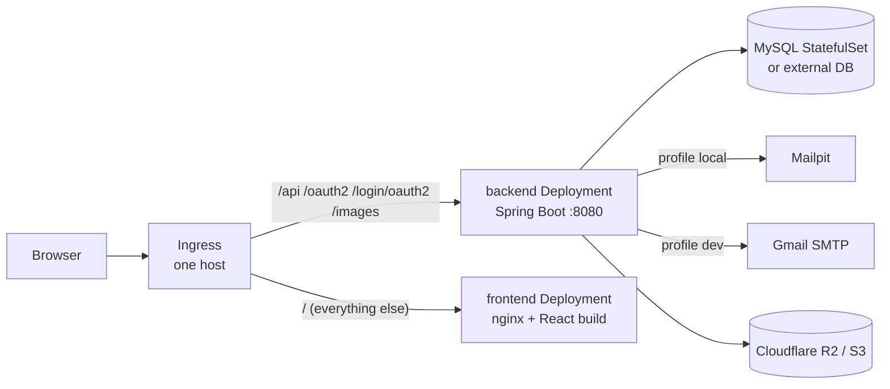

# Deploying to Kubernetes (Helm)

Chart: `helm/smart-booking/` in this repo (deploys the frontend too). Full instructions: [its README](../../helm/smart-booking/README.md). Step-by-step for a local cluster (start, logs, stop, delete): [k8s runbook](../reference/k8s-runbook.md).



Key points:
- **Same host for UI and API.** Build the frontend with `--build-arg VITE_API_URL=/api/v1` (relative), so no CORS and no per-environment frontend builds.
- **Profiles:** `backend.profile: local` (Mailpit, use with `liquibaseContexts: demo`) or `dev` (real SMTP, `prod` data).
- **Secrets** via `secrets.*` (chart creates a Secret) or `existingSecret` (create it yourself; recommended outside local clusters).
- **Probes** use `/actuator/health/{liveness,readiness}`; only `health` is exposed and the ingress doesn't route `/actuator`.
- **Logs:** stdout (`kubectl logs`) plus daily files in `/app/logs` (emptyDir, or a PVC with `backend.logging.persistence.enabled`).
- **One backend replica** with `Recreate` rollouts: scheduled jobs and AI chat state are in-process.
- Object storage is external (R2/S3); `config.storage.endpoint` is required.
- The backend trusts `X-Forwarded-*` headers in the cluster (`FORWARD_HEADERS_STRATEGY=framework`) so OAuth2 redirect URLs use the public scheme/host.

Local test cluster used while building the chart (k3d, separate kubeconfig):

```bash
k3d cluster create smart-booking --port "8080:80@loadbalancer" --kubeconfig-update-default=false --kubeconfig-switch-context=false
export KUBECONFIG=$(k3d kubeconfig write smart-booking)
k3d image import smart-booking-backend:local smart-booking-frontend:k8s -c smart-booking
helm upgrade --install smart-booking helm/smart-booking -n smart-booking --create-namespace -f helm/smart-booking/values-local.yaml
# http://smart-booking.localhost:8080   ·   delete: k3d cluster delete smart-booking
```
